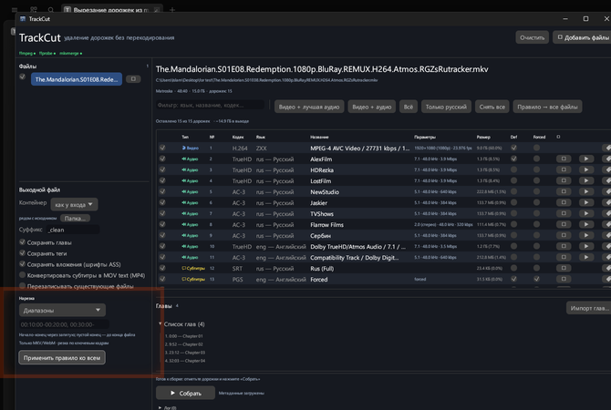

# TrackCut

Удаление ненужных дорожек из MKV и других контейнеров **без перекодирования**.
Видео и оставшиеся аудио/субтитры копируются бит-в-бит, меняется только состав дорожек.

GUI на Rust (`eframe`/`egui`), ядро и CLI — отдельные крейты.





## Что умеет

- MKV, MP4, MOV, WebM, AVI, TS и другие контейнеры, которые понимают ffprobe/mkvmerge.
- Показывает по каждой дорожке: тип, кодек, язык (`rus — Русский`), название перевода
  («Дубляж», «LostFilm», …), каналы, частоту, битрейт, разрешение, FPS, размер и долю файла,
  флаги Default/Forced и **все теги контейнера**. Если контейнер не хранит статистику,
  битрейт и размер оцениваются по первым секундам и помечаются `≈`.
- Прослушивание 15 секунд любой аудиодорожки — чтобы опознать перевод, если названия нет.
- **Извлечение дорожки** в отдельный файл: `MKA` (аудио), `MKS` (субтитры) или `MKV`.
- **Пришивание дорожки из другого файла**: взять озвучку из одного релиза и вставить
  в другой, где лучше видео. Сдвиг в миллисекундах правит рассинхрон, Default/Forced
  выставляются отдельно, внешнюю дорожку можно прослушать перед сборкой.
- **Автоподбор сдвига**: сравнение огибающих громкости двух дорожек — находит рассинхрон
  с точностью до 5 мс и сам подставляет его в поле сдвига (кнопка `⏱` рядом с дорожкой).
- **Окно синхрона** (кнопка «кадр» рядом с дорожкой — своей или внешней): кадр из видео,
  обе дорожки звучат вместе. Сдвиг двигается слайдером или кнопками ±10/100/500 мс, время —
  кнопками ±1/±10 с или «Начало»/«Середина». «Смотреть и слушать» проигрывает 12 секунд
  видео со звуком, «Авто» подбирает сдвиг по звуку и показывает качество совпадения в окне.
- **Сдвиг своих дорожек**: у каждой дорожки файла есть кнопка «сдвиг» — та же подгонка,
  только без перекодирования через mkvmerge (`--sync`).
- **Главы**: список глав с таймкодами прямо в карточке файла, импорт глав из другого
  MKV/WebM или из файла XML/OGM/CUE, отключение глав при сборке.
- **Нарезка**: каждые N минут, по размеру части или по диапазонам
  (`00:10:00-00:20:00, 00:30:00-`) — без перекодирования, резка по ключевым кадрам.
- **Склейка (append)**: приклеить к файлу вторую часть или продолжение — дорожки
  собираются в один файл без перекодирования.

- Пресеты: «Видео + лучшая аудио», «Видео + аудио», «Всё», «Только русский», «Снять все».
- Пакетная обработка: несколько файлов, одно правило, отдельная папка вывода.
- Сохранение глав, тегов, вложений (шрифты ASS) — для MKV.
- Конвертация текстовых субтитров в MOV text при выводе в MP4 (единственное исключение
  из правила «без перекодирования», включается вручную).
- Проверка результата после сборки: повторный probe, сверка состава дорожек и длительности.
- Отмена, атомарная запись через `.part`, исходник никогда не перезаписывается.
- Язык интерфейса: русский (по умолчанию), английский, китайский, японский, французский,
  немецкий, итальянский, испанский и казахский — переключатель «Язык» в левом верхнем
  углу. Выбор сохраняется в `%APPDATA%\TrackCut\ui.ini` (`lang=ru|en|zh|ja|fr|de|it|es|kk`)
  и переживает перезапуск. Названия языковых дорожек переводятся вместе с интерфейсом.
- Все настройки переживают перезапуск: контейнер, папка результата, суффикс, флаги глав,
  тегов и вложений, MOV text, перезапись, режим и параметры нарезки, тема, уведомления,
  размер и позиция окна. Хранятся в том же `ui.ini`. Портативный режим: положите рядом
  с `trackcut.exe` пустой файл `portable.ini` (или `portable.txt`) — настройки будут
  писаться рядом с программой, а не в `%APPDATA%`.
- Тема оформления: тёмная, светлая или системная (как в Windows).
- Уведомление об окончании пакетной сборки: мигание кнопки в панели задач и звук, если
  окно не в фокусе.
- Кнопка «Открыть папку с результатом» под таблицей после сборки: открывает Проводник
  с выделенным готовым файлом.
- Проверка свободного места на диске перед сборкой: если места меньше, чем нужно
  результату, сборка не начинается.
- Проект: «Сохранить проект…» и «Открыть проект…» запоминают список файлов, отметки
  дорожек, сдвиги, главы и склейку в файл `.trackcut` (JSON).
- Интеграция с Проводником: кнопка в «Настройках» добавляет (и убирает) пункт
  «Открыть в TrackCut» в контекстное меню для MKV, MP4, MOV, WebM, AVI и TS.

## Установка

Готовые сборки лежат в `dist\` (и в GitHub Releases):

- **`TrackCut-<версия>-setup.exe`** — обычная установка. Права администратора не нужны:
  программа ставится в профиль пользователя (`%LOCALAPPDATA%\Programs\TrackCut`),
  появляются ярлыки в «Пуск» (и по желанию на рабочем столе), пункт удаления в
  «Программы и компоненты». На шаге «Дополнительно» можно сразу включить пункт
  «Открыть в TrackCut» в меню Проводника.
- **`TrackCut-<версия>-portable.zip`** — портативный вариант: распаковать в любую папку
  и запустить `trackcut.exe`. Рядом лежит `portable.ini`, поэтому настройки пишутся
  в `ui.ini` рядом с программой, а не в `%APPDATA%` — можно носить на флешке.

Обе поставки уже содержат `ffmpeg`, `ffprobe`, `mkvmerge` и `mkvextract`, так что
доустанавливать ничего не нужно. Контрольные суммы — в `dist\SHA256SUMS.txt`.

Пересобрать поставку из исходников:

```powershell
.\pack.ps1               # release-сборка + ZIP + setup.exe (нужен Inno Setup 6)
.\pack.ps1 -SkipBuild    # взять уже собранные exe из target\release
.\pack.ps1 -NoSetup      # только портативный ZIP
```

## Требования

- Windows 10/11 x64 (приложение собрано под GNU-тулчейн, работает и без MSVC).
- Для готовой поставки больше ничего не нужно: MKVToolNix (`mkvmerge`, `mkvextract`)
  и FFmpeg (`ffmpeg`, `ffprobe`) уже лежат в `tools\` внутри архива и установщика.
- При запуске из исходников положите их в `tools\` (см. ниже).

Приложение ищет `ffmpeg.exe`, `ffprobe.exe`, `mkvmerge.exe`:

1. в переменных `TRACKCUT_FFMPEG`, `TRACKCUT_FFPROBE`, `TRACKCUT_MKVMERGE`;
2. в папке `tools` рядом с программой (включая подпапки, например `tools/ffmpeg/bin/`);
3. в `PATH`.

Если чего-то не хватает, вверху окна будет предупреждение и кнопка «Повторить поиск».

## Быстрый старт

```powershell
.\build.ps1            # debug-сборка
.\build.ps1 -Release   # release-сборка
```

Готовые бинарники:

- `target\release\trackcut.exe` — GUI (release);
- `target\release\trackcut-cli.exe` — консоль (release);
- debug-варианты лежат в `target\debug\`.

Запуск GUI:

```powershell
.\run.ps1                 # откроет пустое окно
.\run.ps1 "D:\movie.mkv"  # сразу с файлом
```

Положите `ffmpeg.exe`, `ffprobe.exe` и `mkvmerge.exe` в `tools\ffmpeg\bin\` и `tools\mkvtoolnix\`
(или установите их в PATH) и запустите `trackcut.exe`.

## CLI

```powershell
# Посмотреть дорожки (номера — для --keep/--drop)
trackcut-cli probe "D:\movie.mkv" --verbose

# Удалить дорожку №2, оставить видео и русские субтитры
trackcut-cli mux "D:\movie.mkv" --drop 2 -o "D:\movie_clean.mkv"

# Оставить только дорожки 1 и 3
trackcut-cli mux "D:\movie.mkv" --keep 1,3 -o "D:\out.mkv"

# MKV → MP4 без субтитров, с главами
trackcut-cli mux "D:\movie.mkv" --container mp4 --drop 4,5 -o "D:\out.mp4"

# Сохранить дорожку №3 (озвучку) в отдельный MKA
trackcut-cli extract "D:\dub.mkv" --track 3 -o "D:\dub_rus.mka"

# Пришить эту озвучку к другому файлу, сдвинув её на 250 мс вперёд
trackcut-cli mux "D:\movie.mkv" --drop 2 --add "D:\dub_rus.mka" --add-delay 250 -o "D:\movie_rus.mkv"

# Сдвинуть свою дорожку №3 на 180 мс назад (без перекодирования)
trackcut-cli mux "D:\movie.mkv" --delay 3:-180 -o "D:\movie_sync.mkv"

# Показать план и команду, ничего не запускать
trackcut-cli mux "D:\movie.mkv" --drop 2 --dry-run

# Подобрать сдвиг озвучки по звуку (первая аудиодорожка в каждом файле)
trackcut-cli sync "D:\movie.mkv" "D:\dub_rus.mka"

# ...или указать конкретные дорожки (номера из probe)
trackcut-cli sync "D:\movie.mkv" "D:\dub.mkv" --main-track 1 --extra-track 3

# Взять главы из другого релиза (MKV/WebM извлекаются автоматически, XML — как есть)
trackcut-cli mux "D:\movie.mkv" --chapters "D:\other.mkv" -o "D:\movie_ch.mkv"

# Резать на части по 10 минут (файлы movie_parts-001.mkv, -002, …)
trackcut-cli mux "D:\movie.mkv" --split-duration 00:10:00 -o "D:\movie_parts.mkv"

# Вырезать два диапазона (конец можно не указывать — до конца файла)
trackcut-cli mux "D:\movie.mkv" --split-parts "00:00:00-00:05:00,00:10:00-00:15:00" -o "D:\cut.mkv"

# Резать по 2 ГБ
trackcut-cli mux "D:\movie.mkv" --split-size 2000M -o "D:\movie_parts.mkv"

# Склеить две части в один файл
trackcut-cli mux "D:\part1.mkv" --append "D:\part2.mkv" -o "D:\joined.mkv"
```

`--keep`/`--drop` принимают номера из вывода `probe` (нумерация с 1).
`--add` берёт из указанного файла все дорожки (для `.mka`/`.mks` это ровно одна),
`--add-delay` задаёт им сдвиг в миллисекундах. Флаг `--mov-text` разрешает
конвертацию SRT/ASS → MOV text для MP4.
`--delay UID:МС` сдвигает дорожку самого файла (номер из `probe`, можно повторять:
`--delay 3:-180 --delay 4:120`); сдвиг делается через mkvmerge, поэтому работает
только для MKV/WebM и требует mkvmerge.
`sync` сравнивает огибающие громкости двух дорожек и печатает сдвиг со знаком,
который можно сразу передать в `--add-delay`.
`--chapters` принимает MKV/WebM (главы вынимаются через `mkvextract` во временный XML)
или готовый файл глав (XML/OGM/CUE). `--split-duration`, `--split-size` и `--split-parts`
взаимоисключающие; при нарезке к имени `-o` добавляется `-001`, `-002`, …`.
`--append` можно указывать несколько раз — файлы приклеиваются по порядку.

Для проверки без своего файла есть демо:

```powershell
.\demo\make_sample.ps1     # пересоздать demo\sample.mkv
trackcut-cli probe demo\sample.mkv
trackcut-cli mux demo\sample.mkv --drop 3,5 -o demo\sample_clean.mkv
```

### CLI: JSON

Флаг `--json` глобальный: его можно ставить и до, и после подкоманды
(`trackcut-cli --json probe file.mkv` и `trackcut-cli probe file.mkv --json`
работают одинаково). В JSON-режиме в stdout пишется ровно один JSON-объект,
все человекочитаемые сообщения, прогресс, предупреждения и команды уходят в stderr.
Коды возврата не меняются; при ошибке в stdout попадает `{"error": "..."}`, а код
возврата ненулевой.

Схемы:

```jsonc
// probe
{"file": "C:\\video\\movie.mkv", "info": { /* MediaInfo как есть */ }}

// mux — план, который реально собирался/собран
{"output": "C:\\video\\movie_clean.mkv", "plan": { /* MuxPlan */ }, "verified": true}

// extract — номер первой выбранной дорожки и тип результата
{"output": "C:\\video\\movie.mka", "track": 2, "kind": "audio"}

// sync — сдвиг внешней дорожки и уверенность (0…1), null если оценка недостоверна
{"offset_ms": -250, "confidence": 0.93, "windows_agree": 5, "windows_total": 6, "warnings": []}
```

`verified` появляется только после реальной сборки (не при `--dry-run`): ядро
проверяет результат после mux, поэтому `true` означает, что проверка прошла.
У `extract` при нескольких дорожках `track` — номер первой из них; полный список
дорожек есть в плане команды (stderr). JSON не зависит от `--lang`.

### CLI: язык

`--lang <ru|en|de|fr|es|it|ja|zh|kk>` (глобальный, по умолчанию `ru`) переводит
человекочитаемый вывод: статусы, итоговые строки, предупреждения и ошибки CLI.
Имена кодеков, контейнеров, путей и значения env-переменных не переводятся.
Справка `--help` остаётся на русском. Строки, которые приходят из ядра (например,
тексты предупреждений ffmpeg), сохраняются как есть.

```powershell
trackcut-cli --lang en probe movie.mkv
trackcut-cli probe movie.mkv --lang ja
```

## Как это работает

| Шаг | Что происходит |
|---|---|
| Probe | `ffprobe -show_streams -show_format -show_chapters -of json`; для MKV дополнительно `mkvmerge -J` (точные ID дорожек) |
| Merge | теги/битрейт/размер из ffprobe объединяются с данными mkvmerge по типу и порядку дорожек |
| Plan | выбор дорожек → аргументы `mkvmerge -a/-s/-d` или `ffmpeg -map 0:N -c copy` |
| Extra | внешний файл добавляется вторым входом; из него берутся только выбранные дорожки, со своим `--sync` |
| Chapters | главы из MKV/WebM вынимаются `mkvextract <файл> chapters <xml>`, затем mkvmerge получает `--chapters <xml>` |
| Split | `mkvmerge --split duration:…` / `size:…` / `parts:start-end,…`; части переименовываются из `.part-001` в `-001` |
| Append | к основному входу добавляются `+ файл` — mkvmerge склеивает их в один поток дорожек |
| Extract | `mkvmerge -o track.mka -D -a N -S -B` (или `ffmpeg -map 0:N -c copy -f matroska`) |
| Sync | `ffmpeg -ss … -t … -ac 1 -ar 8k` → огибающая RMS → нормированная корреляция по окнам |
| Mux | запуск процесса с `--gui-mode` / `-progress pipe:1`, разбор прогресса, отмена через kill |
| Verify | повторный probe `.part`-файла: число и типы дорожек, длительность ±2 с |
| Rename | только после проверки: `.part.mkv` → итоговое имя |

Основные модули:

```
crates/core/src/model.rs    модель дорожек и метаданных
crates/core/src/probe.rs    ffprobe + mkvmerge -J и их объединение
crates/core/src/plan.rs     валидация, выбор бэкенда, сборка команд
crates/core/src/extract.rs  сохранение отдельной дорожки в mka/mks/mkv
crates/core/src/chapters.rs извлечение глав из MKV/WebM через mkvextract
crates/core/src/sync.rs     автоподбор сдвига по огибающей звука
crates/core/src/exec.rs     запуск, прогресс, отмена, очистка .part
crates/core/src/verify.rs   проверка результата
crates/gui/src/app.rs       интерфейс
```

## Ограничения

- Нет перекодирования: если контейнер не поддерживает кодек (например, H.264 в WebM),
  приложение предложит MKV, а не будет конвертировать.
- MP4/MOV не хранит PGS/VobSub; SRT/ASS требуют `--mov-text` (или удаления субтитров).
- Вложения (шрифты ASS) переносит только mkvmerge; ffmpeg-бэкенд их теряет и предупреждает.
- Из внешнего файла берутся только дорожки: главы, теги и вложения остаются от основного файла
  (для ASS-субтитров из другого релиза шрифты придётся добавить отдельно).
- Сдвиг применяется к дорожке целиком; при выводе в MP4 через ffmpeg сдвиг задаётся на весь
  вход, поэтому у дорожек из одного файла он должен совпадать.
- Автоподбор сдвига сравнивает громкость, а не речь: при сильном ремиксе, другой разбивке
  на главы или если дорожки из разных монтажей совпадение будет слабым — приложение об этом
  предупредит, результат стоит проверить на слух. Максимальный искомый сдвиг — 8 секунд.
- Прослушивание декодирует 15 секунд во временный WAV — нужен ffmpeg и аудиоустройство.
- Нарезка и склейка работают только через mkvmerge, то есть только для MKV/WebM.
  Резка идёт по ключевым кадрам: граница может сдвинуться до ближайшего keyframe,
  а картинка на стыке частей не пересчитывается.
- Для склейки части должны совпадать по кодекам и параметрам дорожек (обычно это части
  одного релиза); главы и теги при склейке берутся из первого файла.
- Импорт глав поддерживается только для MKV/WebM; из MP4/MOV главы не переносятся.

## Разработка

```powershell
cargo test
cargo clippy -- -D warnings
cargo fmt --check
```

Сборка под GNU-тулчейн:

- Rust: stable, target `x86_64-pc-windows-gnu` (`rustup default stable-x86_64-pc-windows-gnu`);
- MinGW-w64 с `gcc` в `PATH` (например, winlibs UCRT);
- если `gcc` не в `PATH`, путь к линкеру задаётся локально в `.cargo/config.toml`
  (этот файл не входит в репозиторий).

Можно собрать и под MSVC: удалите локальный `.cargo/config.toml` и используйте
стандартный `stable-x86_64-pc-windows-msvc`.

## Roadmap

- [ ] Настройки в `%APPDATA%\TrackCut\config.toml` (пути к инструментам, тема, язык).
- [ ] Сортировка таблицы по столбцам, запоминание фильтра.
- [ ] Редактор глав: правка названий и таймкодов, экспорт в XML.
- [ ] Правка тегов контейнера и дорожек.

## Лицензия

Проект распространяется под двойной лицензией **MIT OR Apache-2.0**: можно выбрать
любую из двух.

- [`LICENSE-MIT`](LICENSE-MIT) — MIT License, Copyright (c) 2026 JetcocosRun.
- [`LICENSE-APACHE`](LICENSE-APACHE) — Apache License, Version 2.0.

Если не указано иное, любой вклад в проект принимается на тех же условиях.

Сторонние программы в поставке распространяются под своими лицензиями: FFmpeg —
GPLv3, MKVToolNix — GPLv2. Тексты лицензий и ссылки на исходники лежат в
`THIRD-PARTY-NOTICES.txt` и в папке `licenses\`. Обе лицензии проекта (MIT и
Apache-2.0) не накладывают ограничений на использование этих программ рядом с
`trackcut.exe`: TrackCut запускает их как отдельные процессы.
